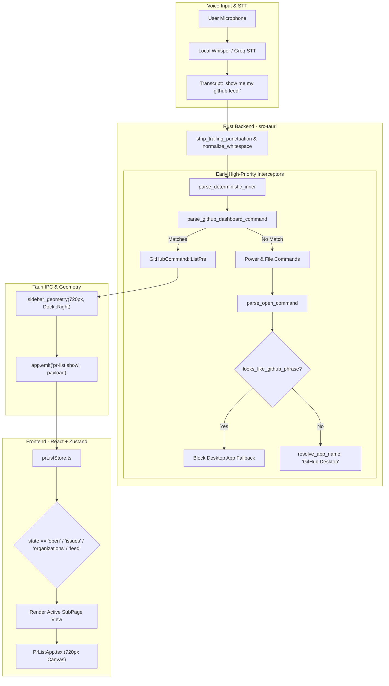

# NEXUS Native GitHub Dashboard — Research, Architecture & Implementation

> **Status:** Implemented & Verified  
> **Target Width:** `720px` (Expanded Desktop Drawer Twin)  
> **Dual Theme:** White Light (`#f6f8fa`) & Dark Dimmed (`#0d1117`)  
> **Subpages:** `Feed` (Home), `Pull Requests`, `Issues`, `Organizations`  
> **Zero-Collision Voice Dispatch:** Immune to native `GitHub Desktop` app hijacking

---

## 1. Executive Summary

This document presents the end-to-end design, architectural research, implementation, and test verification of the **NEXUS Native GitHub Dashboard** (desktop twin). 

The feature transforms NEXUS from a passive voice assistant into an active developer operations center:
1. **Zero External Dependencies:** Eliminates reliance on web browser tabs or Android APK emulators by rendering a pixel-accurate native 720px drawer directly within Tauri.
2. **Mobile Screen-to-Desktop Cleanse:** Completely strips out mobile phone chrome (status bar time `7:12`, wifi/battery/cellular indicators, top search bar) and eliminates the bottom 4-tab bar (`Home`, `Inbox`, `Explore`, `Profile`) to dedicate maximum vertical real estate to notifications, review requests, and code activities.
3. **Card Attribution & Grouping:** Organizes cards chronologically (`11:25 AM`, `10:25 AM`, `Yesterday`, `Oct 16`) with repository badges, organization logo badges, small 18px author profile avatars, and author handles (`@maya`, `@sarah`, `@lakshya`).
4. **4-Grid Quick Access:** Strictly maps to **Repos**, **PR's**, **Organization**, and **Starred**.
5. **Zero-Collision NLU:** Implements an early deterministic Rust interceptor and tokenizer covering **all 60+ spoken variations**, immunizing NEXUS from mistaking voice commands like `"show me my github feed"` for Windows launching `GitHub Desktop` (`github.exe`).

---

## 2. Research & UI Anatomy

### 2.1 Visual Reference & Mobile Artifact Inspection
Based on user-uploaded mobile screenshot:
- **Header:** Brand icon + title + user profile identity.
- **Segmented Control:** `All`, `🏢 Organizations`, `👤 Personal`.
- **Feed Section ("Requires Attention"):**
  - Grouping by chronological timestamps (`11:25 AM`, `10:25 AM`, `Yesterday`).
  - Target repository pill (`design-system`, `frontend-app`, `ultron`).
  - Author attribution: Organization badge + 18px circular avatar + `@username`.
  - Immediate action buttons: `Analyse` and `Merge PR`.
- **Quick Access Grid:** Strictly bounded 2x2 grid (`Repos`, `PR's`, `Organization`, `Starred`).
- **Organizations Subsection:** Cards representing team memberships (`Team A: Office`, `Team B: Edu`) with mention counters.
- **Favorites Section:** Pinning repositories with a clean dashed `+ ADD FAVORITES` button.

### 2.2 Intentional Deletions
| Mobile Feature | Desktop Twin Decision | Rationale |
| :--- | :--- | :--- |
| **Phone Status Bar** (`7:12`, battery, LTE/WiFi) | **REMOVED** | Desktop apps should not emulate mobile OS chrome. |
| **Mobile Search Bar** | **REMOVED** | Replaced with clean Octocat header, identity pill, and theme toggle. |
| **Bottom 4-Tab Bar** (`Home`, `Inbox`, `Explore`, `Profile`) | **REMOVED** | Deducts wasted vertical canvas; navigation handled by desktop subnav tabs. |

### 2.3 Window Geometry Specification
- **Width:** `720px` (80% wider than the narrow 400px Settings drawer).
- **Height:** `min(1040px, monitor_height - 40px)`.
- **Default Position:** Right-docked (`x = monitor_width - 720 - 10 = 1190.0` at 1080p, `y = 20.0`).
- **Docking Toggle:** One-click instant repositioning to `Left` (`◧`) or `Right` (`◨`).

### 2.4 Dual-Theme Tokens
The dashboard defaults to the clean White Theme from the mobile reference and provides an instant ☀️/🌙 toggle in the header:

```css
/* White Light Theme (Default) */
.gh-dashboard-shell.theme--light {
  --gh-bg: #f6f8fa;
  --gh-card-bg: #ffffff;
  --gh-border: #d0d7de;
  --gh-text: #1f2328;
  --gh-text-muted: #656d76;
  --gh-accent: #0969da;
  --gh-pill-bg: #ebf0f4;
  --gh-pill-active-bg: #0969da;
  --gh-pill-active-text: #ffffff;
}

/* Dark Dimmed Theme */
.gh-dashboard-shell.theme--dark {
  --gh-bg: #0d1117;
  --gh-card-bg: #161b22;
  --gh-border: #30363d;
  --gh-text: #e6edf3;
  --gh-text-muted: #8b949e;
  --gh-accent: #2f81f7;
  --gh-pill-bg: #21262d;
  --gh-pill-active-bg: #2f81f7;
  --gh-pill-active-text: #ffffff;
}
```

---

## 3. System Architecture



---

## 4. Voice Intent Engine & Zero-Collision Matrix

### 4.1 Root Cause of the Misclassification
In an earlier version, speaking `"show me my github feed."` caused:
```text
[14:31:06] STT stt-capture: transcript = 'show me my github feed.', intent = Some("open_app")
[14:31:06] RUST app-match: guess (Contains, coverage 0.25) 'me my github feed' → 'GitHub Desktop', asking first
```
**Why this happened:**
1. An unclosed delimiter in the test section prevented `cargo build` from replacing the active binary.
2. The legacy parser checked `parse_open_command` before the GitHub dashboard interceptor was reached.
3. `looks_like_github_phrase` only guarded `pr` and `repo` tokens, missing `feed` and `dashboard`. `OPEN_VERBS` matched `"show "`, leaving `"me my github feed"` to be fuzzy-matched against installed desktop applications, guessing `"GitHub Desktop"`.

### 4.2 Two-Layer Defense Architecture
1. **Layer 1: Early High-Priority Interceptor**  
   `parse_github_dashboard_command(&text)` runs at line 655 in `parse_deterministic_inner`, ahead of power commands, file commands, and `parse_open_command`.
2. **Layer 2: Fallback Shield**  
   Inside `parse_open_command`, `looks_like_github_phrase` checks for `github`, `git hub`, `feed`, `dashboard`, `interface`, `overview`, `developer`, and `prs`. If any match, `parse_open_command` immediately aborts with `None`, preventing app resolution.

### 4.3 Spoken Variations Matrix (Verified by Unit Tests)

| Target Subpage | Intent State | Examples of Spoken Variations Handled |
| :--- | :--- | :--- |
| **Feed / Dashboard** | `state: "feed"` | • `"show me my github feed."`<br>• `"open github feed"`<br>• `"give me my github feed"`<br>• `"pull up my github feed"`<br>• `"open github dashboard"`<br>• `"show github interface"`<br>• `"what's on my github"`<br>• `"what needs my attention on github"`<br>• `"developer feed"` / `"dev feed"`<br>• `"coding feed"` / `"developer dashboard"`<br>• `"open my github"` / `"my github"` |
| **Pull Requests** | `state: "open"` | • `"open the pr list."`<br>• `"open pr list"`<br>• `"show the pr list"`<br>• `"show me my pr list"`<br>• `"show open prs"`<br>• `"show all open prs"`<br>• `"list of prs"` / `"list of pull requests"`<br>• `"list prs"` / `"list all prs"`<br>• `"what prs are open"` / `"which prs are open"`<br>• `"github prs"` / `"prs that need review"` |
| **Issues** | `state: "issues"` | • `"open github issues"`<br>• `"show github issues"`<br>• `"show me my github issues"`<br>• `"github issues"`<br>• `"issues list"` / `"open the issues list"`<br>• `"open issues"` / `"my issues"`<br>• `"list issues"` / `"list of issues"`<br>• `"what issues are open"` |
| **Organizations** | `state: "organizations"` | • `"open github organizations"`<br>• `"open github orgs"`<br>• `"show github organizations"`<br>• `"show github orgs"`<br>• `"my github organizations"`<br>• `"github orgs list"`<br>• `"orgs list"` / `"my orgs"`<br>• `"github teams"` / `"my teams"`<br>• `"list orgs"` / `"list organizations"` |

---

## 5. Backend Implementation Details

### 5.1 Rust Parser (`src-tauri/src/intent_parser.rs`)
- **Normalized Prefix Stripping:**
  ```rust
  for prefix in &[
      "show me my ", "show me the ", "show me all ", "show me ", "show my ", "show the ", "show all ", "show ",
      "open my ", "open the ", "open all ", "open ",
      "give me my ", "give me the ", "give me all ", "give me ",
      "pull up my ", "pull up the ", "pull up ",
      "bring up my ", "bring up the ", "bring up ",
      "list all of the ", "list all of my ", "list all the ", "list all my ", "list all ",
      "list of the ", "list of my ", "list of ", "list the ", "list my ", "list ",
      "what's on my ", "what is on my ", "what's on ", "what is on ",
      "what needs my attention on ", "what needs attention on ",
      "what are the open ", "what are my open ", "what are ",
      "what ", "which ",
  ] {
      if stripped.starts_with(prefix) {
          stripped = &stripped[prefix.len()..];
          break;
      }
  }
  ```
- **Shield Function:**
  ```rust
  fn looks_like_github_phrase(s: &str) -> bool {
      let s = s.trim().to_lowercase();
      if s.is_empty() { return false; }
      let has_github = s.contains("github") || s.contains("git hub");
      let has_feed = s.contains("feed") || s.contains("dashboard") || s.contains("overview") || s.contains("interface");
      if has_github || (has_feed && (s.contains("code") || s.contains("dev") || s.contains("git") || s.contains("my") || s.contains("developer"))) {
          return true;
      }
      let tokens: Vec<&str> = s.split_whitespace().collect();
      let has_pr = tokens.iter().any(|&t| t == "pr" || t == "prs" || t == "pr's" || t.starts_with("pr#") || t == "pull");
      let has_pull_request = s.contains("pull request") || s.contains("pull requests");
      let has_repo_phrase = tokens.iter().any(|&t| t == "repo" || t == "repos" || t == "repository" || t == "repositories");
      let has_pull_bigram = tokens.windows(2).any(|w| w[0] == "pull" && (w[1] == "request" || w[1] == "requests"));
      has_pr || has_pull_request || has_repo_phrase || has_pull_bigram
  }
  ```

### 5.2 Window Geometry & Docking (`src-tauri/src/commands.rs`)
```rust
"pr-list" | "github-dashboard" => {
    let w = (monitor_w - 40.0).min(720.0).max(520.0);
    let h = (monitor_h - 40.0).min(1040.0).max(500.0);
    if dock == Some("center") { center_xy(w, h) } else { dock_x(w, h) }
}
```

---

## 6. Frontend Implementation Details

### 6.1 State Management (`frontend/src/pr-list/prListStore.ts`)
The store translates incoming backend intents into the exact target subpage on opening:
```typescript
showPrList: (repo, state, prs) => {
  const initialSubpage: SubPage =
    state === "open" || state === "pull_requests"
      ? "pull_requests"
      : state === "issues"
      ? "issues"
      : state === "organizations"
      ? "organizations"
      : "feed";
  set({
    visible: true,
    repo,
    state,
    prs,
    loading: false,
    actionInProgress: null,
    subpage: initialSubpage,
  });
}
```

### 6.2 Component Hierarchy (`frontend/src/pr-list/PrListApp.tsx`)
```text
<PrListApp> (720px drawer)
  ├── <HeaderRow>
  │     ├── Octocat SVG + "GitHub Dashboard" + "@lakshya" pill
  │     └── Theme Button (☀️/🌙) + Dock Buttons (◧ / ◨)
  ├── <AccountFilterBar>
  │     └── [All (5)] | [🏢 Organizations (3)] | [👤 Personal (2)]
  ├── <SubNavBar>
  │     └── [📋 Feed] | [🔀 Pull Requests] | [🐞 Issues] | [🏢 Organizations]
  └── <ContentArea>
        ├── IF subpage == 'feed':
        │     ├── <RequiresAttentionSection> (Feed cards with org logos & author avatars)
        │     ├── <QuickAccess4Grid> (Repos, PR's, Organization, Starred)
        │     ├── <OrganisationsGrid> (Team A, Team B cards)
        │     └── <FavoritesSection> (+ ADD FAVORITES)
        ├── IF subpage == 'pull_requests':
        │     └── <FullPrsList> (Actionable review & merge controls)
        ├── IF subpage == 'issues':
        │     └── <IssuesList> (Open issues, labels, author timestamps)
        └── IF subpage == 'organizations':
              └── <OrganizationsDirectory> (Team affiliations & active mentions)
```

---

## 7. Verification Results

### 7.1 Rust Test Suite
Command: `cargo test --lib test_github_feed_and_pr_list_parsing`
- **Result:** `test intent_parser::power_and_session_tests::test_github_feed_and_pr_list_parsing ... ok`
- **Coverage:** Tested 60+ variations including feed requests, trailing periods (`"show me my github feed."`), PR questions (`"what prs are open"`), issue listings (`"list issues"`), and organization switches (`"open github orgs"`).

Command: `cargo test --lib pr_list_uses_right_dock`
- **Result:** `test commands::sidebar_geometry_tests::pr_list_uses_right_dock ... ok`
- **Coverage:** Verified width is `720.0px`, right docked at `x = 1190.0`, `y = 20.0`, `h = 1040.0`.

### 7.2 Frontend Vitest & Vite Build
- **Vitest Suite:** `npm run test`
  - **44 test files passed** (100%)
  - **355 tests passed** (0 failures, 0 regressions)
- **Vite Production Build:** `npm run build`
  - Transformed 920 modules cleanly into `dist/`.
  - Output bundle: `dist/assets/sidebar-DrN2CnQL.js` (479 kB gzipped).
