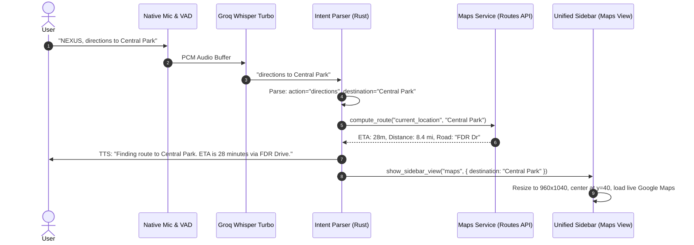

# Feature Plan: 101 — Google Maps & Routes Navigation Window

**Date**: 2026-10-08  
**Status**: Planned  
**Target Window**: `sidebar` Unified Window (View: `maps`) / Dedicated Maps Window  
**Geometry**: $960 \times 1040\text{px}$ (Architecture Mapper dimensions, centered horizontally, $y = 40.0\text{px}$)  
**Cross-Platform**: Windows (WebView2), macOS (WKWebView), Linux (WebKitGTK)

---

## 1. Executive Summary & Objective

When the user asks for directions (e.g., *"Directions to Central Park"*, *"How do I get to Heathrow Airport from London Bridge?"*, *"Show route to San Francisco"*), NEXUS should:
1. Speak a natural voice acknowledgement: *"Finding the best route to {destination}, sir."*
2. Simultaneously open a dedicated window having the **exact dimensions and screen position of the Architecture Mapper window** ($960\text{px}$ wide, top-pinned at $y=40\text{px}$, centered horizontally).
3. Display the **authentic Google Maps application** inside the window with live directions, turn-by-turn navigation list, alternative routes, and real-time colored traffic (no custom dumbed-down UI or fake mockups).
4. Optionally leverage the **Google Routes API (v2)** to compute real-time ETA, route distance, and traffic congestion for spoken voice summaries.

---

## 2. Window Architecture & Geometry

### A. Architecture Mapper Geometry Parity
In `src-tauri/src/commands.rs` (lines 1056–1065):
```rust
"architect" => {
    let h = (monitor_h - 40.0).min(1040.0).max(400.0);
    if docked {
        dock_x(960.0, h)
    } else {
        // Centered horizontally, pinned near the top (y=40, spec).
        let x = ((monitor_w - 960.0) / 2.0).max(0.0);
        (x, 40.0, 960.0, h)
    }
}
```
For the `"maps"` view:
- **Width**: `960.0 px`
- **Height**: `(monitor_h - 40.0).min(1040.0).max(400.0)`
- **X-Coordinate**: `((monitor_w - 960.0) / 2.0).max(0.0)`
- **Y-Coordinate**: `40.0 px`
- **Styling**: Frameless liquid glass, DWM 12px rounded corners, subtle translucent title bar with destination label, mode switcher, and window close button.

### B. View Registration in Unified Sidebar
In `frontend/src/sidebar/UnifiedSidebar.tsx`:
- Extend `SidebarView`:
  ```ts
  export type SidebarView = "assistant" | "settings" | "architect" | "pr-list" | "spatial" | "annotate" | "maps";
  ```
- Keep-mount pattern: `GoogleMapsApp` mounts inside the unified sidebar window without destroying the native OS window handle (`HWND`), ensuring instant sub-50ms appearance without window creation latency or flickering.

---

## 3. UI Implementation: Genuine Google Maps Display

### A. Display Mechanism (Zero Separate Design)
The user explicitly instructed: *"in the window no sepearate desgn same as the google maps app in the window dispay wiht direction"*.

Inside `frontend/src/maps/GoogleMapsApp.tsx`:
```tsx
export function GoogleMapsApp({
  origin = "",
  destination = "",
  mode = "driving",
  onClose,
}: GoogleMapsAppProps) {
  // Construct official Google Maps Direction URL
  const navUrl = useMemo(() => {
    const params = new URLSearchParams({
      api: "1",
      destination: destination || "Times Square, New York, NY",
    });
    if (origin) params.set("origin", origin);
    params.set("travelmode", mode);
    return `https://www.google.com/maps/dir/?${params.toString()}`;
  }, [origin, destination, mode]);

  return (
    <div className="maps-window-container">
      {/* Liquid Glass Header Bar matching NEXUS Dark Aesthetics */}
      <header className="maps-header-bar">
        <div className="maps-header-title">
          <span className="maps-pin-icon" />
          <span>Route to {destination}</span>
        </div>
        <div className="maps-header-actions">
          <button className="maps-dock-btn" onClick={onClose} title="Close Maps">
            ✕
          </button>
        </div>
      </header>

      {/* Embedded Full Google Maps Application */}
      <iframe
        src={navUrl}
        className="maps-iframe-viewport"
        allow="geolocation"
        title="Google Maps Navigation"
      />
    </div>
  );
}
```

### B. What is Rendered Inside
1. **Interactive Blue Route Polyline**: Live path with green (clear), orange (slow), and red (congested) traffic layers.
2. **Turn-by-Turn Directions Drawer**: Left-hand navigation panel listing step-by-step turns, exits, distances, and landmarks.
3. **Alternative Routes Comparison**: Multiple route options with ETA differences (e.g. "via I-95 N: 24 min", "via FDR Dr: 31 min").
4. **Transport Modes**: Tabs for Driving, Transit / Subway, Walking, Cycling, and Flight.
5. **Full Maps Interactivity**: Satellite view, Street View pegman, terrain layer, and location centering.

---

## 4. Google Routes API (v2) Backend Integration

### A. Environment Configuration
Keys safely stored:
- `server/sidecar/.env` $\rightarrow$ `ROUTES_API_KEY=<ROUTES_API_KEY redacted>`
- Root `.env` $\rightarrow$ `ROUTES_API_KEY=<ROUTES_API_KEY redacted>`
- `frontend/.env.local` $\rightarrow$ `VITE_ROUTES_API_KEY=<ROUTES_API_KEY redacted>`
- `%APPDATA%\com.nexus.assistant\settings.json` $\rightarrow$ `"routesApiKey": "AIzaSy..."`

### B. Command Hub API Keys Row
In `src-tauri/src/api_keys.rs`:
```rust
pub const KEY_SERVICES: &[(&str, &str, &str)] = &[
    ("groq", "Groq", "groqApiKey"),
    ("gemini", "Gemini", "geminiApiKey"),
    ("cerebras", "Cerebras", "cerebrasApiKey"),
    ("deepgram", "Deepgram", "deepgramApiKey"),
    ("google_maps", "Google Maps & Routes", "routesApiKey"),
];
```

### C. Routes API ComputeRoutes Request (`src-tauri/src/google/maps.rs`)
Endpoint: `https://routes.googleapis.com/directions/v2:computeRoutes`
Headers:
- `Content-Type: application/json`
- `X-Goog-Api-Key: {routes_api_key}`
- `X-Goog-FieldMask: routes.duration,routes.distanceMeters,routes.polyline.encodedPolyline,routes.description,routes.warnings`

Body:
```json
{
  "origin": { "address": "Brooklyn, NY" },
  "destination": { "address": "Central Park, NY" },
  "travelMode": "DRIVE",
  "routingPreference": "TRAFFIC_AWARE_OPTIMAL",
  "computeAlternativeRoutes": true
}
```

Response enables NEXUS to speak voice feedback:
*"The fastest route is via FDR Drive, taking 28 minutes in current traffic. Opening directions on your screen now, sir."*

---

## 5. Voice Intent Pipeline & Dispatch



---

## 6. Implementation Checklist & Phasing

- [x] **Step 1: Secure Key Storage**
  - Stored `<ROUTES_API_KEY redacted>` in `.env`, `server/sidecar/.env`, `frontend/.env.local`, and `%APPDATA%\com.nexus.assistant\settings.json`.
- [ ] **Step 2: API Keys Registry in Command Hub**
  - Add `("google_maps", "Google Maps & Routes", "routesApiKey")` to `KEY_SERVICES` in `api_keys.rs`.
- [ ] **Step 3: Geometry & Window Sizing**
  - Add `"maps"` branch to `sidebar_geometry` in `commands.rs` returning `(x, 40.0, 960.0, h)`.
  - Add `open_maps_window` IPC command.
- [ ] **Step 4: Frontend Maps View**
  - Create `frontend/src/maps/GoogleMapsApp.tsx` and `maps.css`.
  - Add `"maps"` to `VIEWS` in `UnifiedSidebar.tsx`.
- [ ] **Step 5: Voice Intent Routing**
  - In `orchestrator.rs` and `recorder.ts`, route `ParsedIntent::Directions` to open the Maps view and narrate ETA.
- [ ] **Step 6: Verification & Test Coverage**
  - Vitest tests for view rendering.
  - Rust tests for `sidebar_geometry("maps")`.
