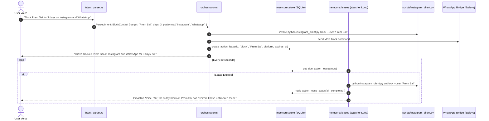

# Feature 108: Timed Social Contact Blocking & Memory Action Leases

## 1. Executive Summary & User Experience

Social media platforms (Instagram, WhatsApp) lack native scheduled or temporary blocking. If a user blocks someone to focus or avoid distractions, they inevitably forget to unblock them days later, or must manage manual calendar reminders.

NEXUS solves this by introducing **Memory Action Leases** — durable, time-bounded SQLite records coupled with platform automation bridges. The user commands NEXUS naturally via voice:
- *"Hey Nexus, block Prem Sai for 3 days on Instagram, WhatsApp, and phone."*
- *"Block Prem Sai until November 13th."*
- *"Who is currently blocked right now?"*
- *"Unblock Prem Sai on Instagram."*

### Key Guarantees
1. **Immediate Execution**: The block call is made instantaneously across the requested platform APIs.
2. **Reboot Resilience**: Action leases are persisted in SQLite (`action_leases` table). If the laptop is rebooted or powered off when an unblock expires, NEXUS executes the unblock immediately upon boot and informs the user.
3. **Transparent Status**: Saying *"who is currently blocked"* generates a dark-mode status card in the liquid-glass sidebar and speaks a concise audit.

---

## 2. System Architecture & Lifecycle



---

## 3. Data Schema & SQLite Store Implementation

The action lease store resides in `memcore.db` within `src-tauri/src/memcore/store.rs`:

```sql
CREATE TABLE IF NOT EXISTS action_leases(
    id TEXT PRIMARY KEY,
    action_type TEXT NOT NULL,         -- 'block' | 'reminder' | 'focus'
    target_name TEXT NOT NULL,         -- 'Prem Sai'
    platform TEXT NOT NULL,            -- 'instagram' | 'whatsapp' | 'phone'
    target_identifier TEXT NOT NULL,   -- '@premsai' or phone number
    expires_at INTEGER NOT NULL,       -- Unix timestamp (seconds)
    created_at INTEGER NOT NULL,       -- Unix timestamp (seconds)
    status TEXT NOT NULL               -- 'active' | 'completed' | 'cancelled'
);

CREATE INDEX IF NOT EXISTS idx_action_leases_due
ON action_leases(status, expires_at);
```

### Rust Structure (`memcore::store::ActionLease`)
```rust
#[derive(Debug, Clone, PartialEq, Eq, serde::Serialize, serde::Deserialize)]
pub struct ActionLease {
    pub id: String,
    pub action_type: String,
    pub target_name: String,
    pub platform: String,
    pub target_identifier: String,
    pub expires_at: i64,
    pub created_at: i64,
    pub status: String,
}
```

### Store Operations
- `create_action_lease(&self, lease: &ActionLease) -> rusqlite::Result<()>`: Atomically records the lease and sets the dirty bit for persistence.
- `get_due_action_leases(&self, now_ts: i64) -> rusqlite::Result<Vec<ActionLease>>`: Index-accelerated query finding all active leases where `expires_at <= now_ts`.
- `mark_action_lease_status(&self, id: &str, status: &str) -> rusqlite::Result<()>`: Transitions a lease from `active` to `completed` or `cancelled`.
- `list_active_action_leases(&self) -> rusqlite::Result<Vec<ActionLease>>`: Lists all currently engaged blocks/leases for UI inspection.
- `cancel_action_leases_for(&self, target_name: &str, platform: &str) -> rusqlite::Result<usize>`: Cancels active leases when the user manually requests an early unblock.

---

## 4. Platform Automation Bridges

### Instagram Bridge (`scripts/instagram_client.py`)
Utilizes `instagrapi` (`3.0.22`) with session caching in `%LOCALAPPDATA%\NEXUS\instagram_session.json`:
- **Block Command**:
  ```bash
  python scripts/instagram_client.py block --user "premsai"
  ```
- **Unblock Command**:
  ```bash
  python scripts/instagram_client.py unblock --user "premsai"
  ```
- **Mock Mode**: Supports `--mock` flag for offline testing and continuous integration without requiring live Instagram credentials.

### WhatsApp Bridge
Integrated via local Baileys WebSocket bridge at `http://127.0.0.1:8765`:
- Resolves contact JID from `memcore::people` or phone number.
- Sends native contact privacy block update.

---

## 5. Spoken Phrasing & Natural Language Parsing

In `src-tauri/src/intent_parser.rs`, deterministic regex and token pattern matching support:
1. **Temporal Durations**:
   - `block <name> for <N> days` $\rightarrow$ `days = N`
   - `block <name> for <N> hours` $\rightarrow$ `days = N / 24.0`
   - `block <name> until <Month> <Day>` $\rightarrow$ computes delta days to target date.
2. **Multi-Platform Targeting**:
   - Matches keywords: `instagram`, `insta`, `whatsapp`, `wa`, `phone`, `number`.
   - Defaults to all active social platforms if unspecified.
3. **Status Audit**:
   - *"who is blocked"*, *"list blocked contacts"*, *"active blocks"*.

---

## 6. Failure Modes & Edge Cases

| Failure Mode | Mitigation |
|---|---|
| Laptop shut down when lease expires | On boot, `session::at_boot` queries all leases where `expires_at <= now`. Expired leases are unblocked immediately, and the greeting reports: *"While you were away, 1 temporary block expired and was lifted."* |
| Target contact has no username/ID | The system defaults to matching known contacts in `memcore::people` or `contacts.json`. If ambiguous, NEXUS asks for clarification. |
| Instagram rate limit / session challenge | `instagram_client.py` captures HTTP 429/checkpoint exceptions and reports an honest error without crashing the lease thread. |
| User requests early unblock | The `ParsedIntent::UnblockContact` handler calls the platform unblock API and marks the database lease as `cancelled`. |

---

## 7. Verification & Test Suite

1. **SQLite Lifecycle Test**:
   ```bash
   cargo test --lib -- memcore::store::tests::action_leases_lifecycle
   ```
2. **Background Expiry Dispatcher Test**:
   ```bash
   cargo test --lib -- memcore::leases::tests::process_due_leases_handles_expiry
   ```
3. **Intent Parsing Test**:
   ```bash
   cargo test --lib -- intent_parser::power_and_session_tests::test_social_block_parsing
   ```
4. **Instagram CLI Mock Test**:
   ```bash
   python scripts/instagram_client.py block --user premsai --mock
   python scripts/instagram_client.py unblock --user premsai --mock
   ```
