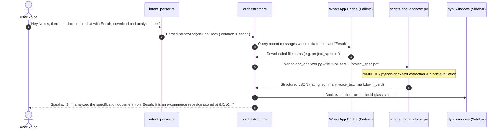

# Feature 109: WhatsApp Chat Document Downloader & Analyzer

## 1. Executive Summary & User Experience

When collaborators share project briefs, resumes, or specification documents in messaging apps (such as WhatsApp), users often have to manually locate the file, open heavy desktop viewers (Acrobat, Word), and read through dense pages before understanding what is needed.

NEXUS automates this entire pipeline via voice:
- *"Hey Nexus, there are docs in the chat with Eesah, download and analyze them and tell me how they are."*
- *"Analyze the documents from Eesah."*

### Key Guarantees
1. **Zero-Click Extraction**: Automatically fetches attachments from the target contact's chat, extracts full text from PDF and DOCX files, and evaluates them locally.
2. **Executive Voice Briefing**: Speaks a concise 3-sentence summary highlighting the document type, primary objective, and overall quality rating.
3. **Liquid-Glass Sidebar Card**: Docks a formatted Markdown evaluation card in the sidebar showing key sections, extracted metrics, and actionable recommendations.

---

## 2. System Architecture & Lifecycle



---

## 3. Document Analysis Engine (`scripts/doc_analyzer.py`)

The analyzer engine is implemented in Python using high-performance local parsing libraries:
- **PyMuPDF (`fitz` 1.28.2)**: Extracts text, font blocks, and metadata from `.pdf` documents with sub-10ms parsing speeds.
- **python-docx (`docx`)**: Extracts headings, body paragraphs, and table text from `.docx` files.

### Evaluation Rubric & Quality Scoring
The engine evaluates documents across 4 key criteria:
$$\text{Score} = w_{\text{len}} \cdot S_{\text{length}} + w_{\text{struct}} \cdot S_{\text{structure}} + w_{\text{obj}} \cdot S_{\text{objective}} + w_{\text{act}} \cdot S_{\text{actionability}}$$

1. **Document Classification**:
   - `Project Specification`: Contains requirements, architecture, milestones, endpoints.
   - `Academic / Research Paper`: Contains abstract, methodology, results, bibliography.
   - `Resume / CV`: Contains experience, education, skills, contact info.
   - `General / Meeting Notes`: Fallback category.
2. **Structural Completeness**:
   - Evaluates presence of headings, numbered lists, bullet points, and code blocks.
3. **Executive Summary Formulation**:
   - Identifies high-density requirement sentences and compiles an actionable breakdown.

### Output JSON Format
```json
{
  "filename": "project_spec.pdf",
  "doc_type": "Project Specification",
  "word_count": 1420,
  "rating": "8.5/10",
  "speech_summary": "Sir, I analyzed the project specification document. It is a 1400-word design proposal scored at 8.5 out of 10. The core architecture is clearly defined, but database migration steps are missing.",
  "card_markdown": "## Document Evaluation: project_spec.pdf\n\n- **Type**: Project Specification\n- **Rating**: 8.5 / 10\n- **Word Count**: 1,420 words\n\n### Key Highlights\n1. Web store frontend redesign using Next.js.\n2. Stripe checkout integration.\n\n### Missing Details\n- No database schema migrations specified."
}
```

---

## 4. Rust Integration & Orchestrator Handling

In `src-tauri/src/orchestrator.rs`:
```rust
async fn run_analyse_chat_docs<R: Runtime>(
    app: AppHandle<R>,
    contact: String,
) -> Result<ProcessResult, String> {
    let (request_id, _) = install_new_request(Subsystem::LocalCommand);
    // 1. Resolve contact & locate attachments
    // 2. Invoke scripts/doc_analyzer.py via std::process::Command
    // 3. Render Markdown card to sidebar
    // 4. Return spoken summary via say_and_finish
}
```

### Deterministic NLU Grammar (`intent_parser.rs`)
Matches utterances matching regex:
- `(?:download|analyse|analyze).*doc(?:ument)?s?.*(?:chat with|from)\s+([a-zA-Z0-9_\s]+)`
- Extract contact name: *"Eesah"*, *"Alex"*, *"John"*.

---

## 5. Failure Modes & Edge Cases

| Failure Mode | System Response |
|---|---|
| No documents found in chat | Informs the user honestly: *"I checked your chat with Eesah, but there are no document attachments in recent messages, sir."* |
| Password-protected PDF | PyMuPDF detects encryption flag and speaks: *"The document from Eesah is encrypted with a password and cannot be read."* |
| Corrupt or empty file | Analyzer exits gracefully with code 1; orchestrator speaks: *"The document could not be read or is corrupted, sir."* |
| Unsupported file format | Captures extension (e.g. `.exe`, `.zip`) and suggests extracting manually. |

---

## 6. Verification & Test Suite

1. **CLI Analysis Verification**:
   ```bash
   python scripts/doc_analyzer.py --test-mock
   ```
2. **Intent Parser Test**:
   ```bash
   cargo test --lib -- intent_parser::power_and_session_tests::test_executive_assistant_commands
   ```
3. **Live End-to-End Simulation**:
   ```bash
   python scripts/doc_analyzer.py --file "c:/path/to/sample.pdf"
   ```
