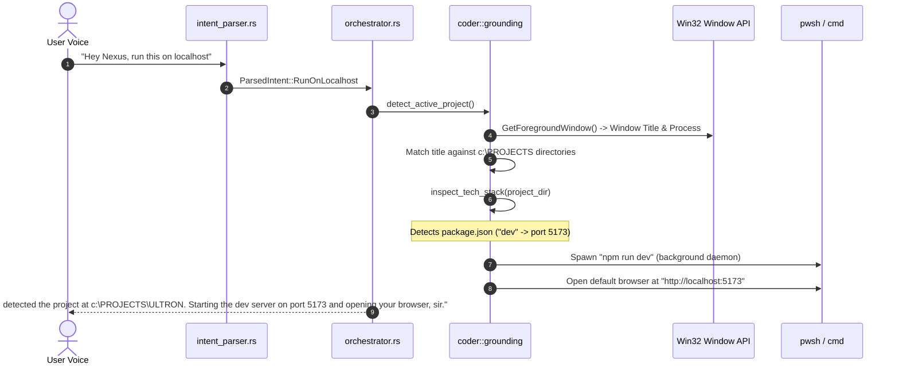

# Feature 110: Universal Screen Grounding & Localhost Dev Runner

## 1. Executive Summary & User Experience

Developers frequently switch between multiple repositories, editor windows, and terminal tabs. Launching a project requires remembering which folder is open, checking its package manager scripts (`npm run dev`, `cargo run`, `flask run`), and opening a browser to the right port (`5173`, `3000`, `8080`).

NEXUS introduces **Universal Screen Grounding**:
- The user simply looks at their editor or terminal and says: *"Hey Nexus, run this on localhost."*
- NEXUS identifies the active window, discovers the workspace root, detects the language and build tool, launches the development server in the background, and opens the running application in the user's default browser.

### Key Guarantees
1. **Zero Path Specification**: Infers the project from the active foreground window title (e.g. `ULTRON - Visual Studio Code`, `my-app - Trae`).
2. **Multi-Stack Auto-Detection**: Native inspection for Node.js (Vite, Next.js, React), Rust (Cargo), Python (FastAPI, Flask, Django), Go, and static HTML.
3. **Automatic Port Resolution**: Identifies the framework's canonical localhost port and verifies connectivity.

---

## 2. System Architecture & Lifecycle



---

## 3. Grounding Heuristics & Tech Stack Inspection

Implemented in `src-tauri/src/coder/grounding.rs`:

### 1. Active Window Title Parsing
When a user speaks while looking at their IDE:
- Window titles typically take the format: `[File/Project] - [Editor]`, such as:
  - `ULTRON - Visual Studio Code`
  - `my-web-app — Trae`
  - `portfolio — Cursor`
- `extract_project_name_from_title(title: &str) -> Option<String>` extracts the project token and scans:
  1. `c:\PROJECTS\<name>`
  2. Current working directory
  3. Parent directory search for root markers (`package.json`, `.git`, `Cargo.toml`)

### 2. Multi-Stack Detection Heuristic

```rust
pub enum TechStack {
    Node { script: String, port: u16 },
    Rust { port: u16 },
    Python { runner: String, port: u16 },
    Go { port: u16 },
    StaticHtml { port: u16 },
    Unknown,
}
```

Inspection logic checks files in priority order:
1. **`package.json`**:
   - Parses `scripts` object for `"dev"`, `"start"`, `"serve"`.
   - Checks dependencies: `vite` $\rightarrow$ port 5173; `next` $\rightarrow$ port 3000; `react-scripts` $\rightarrow$ port 3000; `astro` $\rightarrow$ port 4321.
2. **`Cargo.toml`**:
   - Inspects for `[package]`. Command: `cargo run`. Default web port: 8080 / 3000.
3. **Python (`pyproject.toml`, `requirements.txt`, `manage.py`, `app.py`)**:
   - `manage.py` present $\rightarrow$ `python manage.py runserver` (port 8000).
   - `app.py` / `main.py` $\rightarrow$ `uvicorn` or `python app.py` (port 8000 / 5000).
4. **`go.mod`**:
   - Command: `go run .` (port 8080).
5. **`index.html`**:
   - Spawns lightweight Python static server: `python -m http.server 8000`.

---

## 4. Spoken Utterances & Parsing

In `src-tauri/src/intent_parser.rs`:
Matches intent `ParsedIntent::RunOnLocalhost` for queries:
- *"run this on localhost"*
- *"start localhost dev server"*
- *"run project in browser"*
- *"open localhost for this"*

---

## 5. Failure Modes & Edge Cases

| Failure Mode | Mitigation |
|---|---|
| Foreground window is not an IDE / returns 0 | Falls back to checking the current working directory (`CWD`), or scans the most recently modified repository under `c:\PROJECTS`. |
| Port already in use (e.g. EADDRINUSE 5173) | Modern dev tools (like Vite) auto-increment to 5174; the grounding module inspects stdout or opens the base URL. |
| No runnable stack found | Informs the user honestly: *"I found the directory at {dir}, but could not identify a package.json or Cargo.toml to launch."* |
| Long-running dev server blocks thread | Process is spawned asynchronously with `std::process::Command` detached or daemonized, avoiding UI blocking. |

---

## 6. Verification & Test Suite

1. **Title Token Extraction Test**:
   ```bash
   cargo test --lib -- coder::grounding::tests::test_extract_project_name
   ```
2. **Directory Stack Inspection Test**:
   ```bash
   cargo test --lib -- coder::grounding::tests::test_inspect_current_dir
   ```
3. **Intent Parser Test**:
   ```bash
   cargo test --lib -- intent_parser::power_and_session_tests::test_coding_command_parsing
   ```
