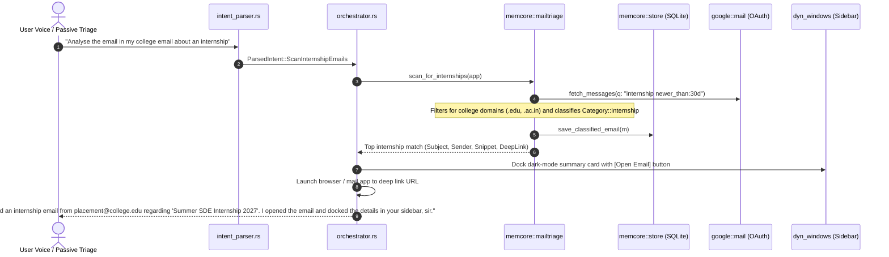

# Feature 112: College Email Internship Radar

## 1. Executive Summary & User Experience

College students and interns receive dozens of departmental notices, newsletter blasts, and circulars daily. Critical internship openings, stipend announcements, and campus placement deadlines are easily buried in inbox noise.

The **College Email Internship Radar**:
- Scans multi-account college inboxes (`.edu`, `.ac.in`) for career opportunities.
- Extracts role titles, stipend values, and application deadlines.
- Generates a 1-click deep link directly to the email thread in Gmail or the default mail client.
- **Zero-Spam Policy**: Respects the user directive that proactivity must never interrupt speech unsolicited. Discovered opportunities are docked silently as dark-mode summary cards in the sidebar, speaking only when explicitly queried.

### Voice Queries
- *"Analyse the email I received in my college email about an internship."*
- *"Check my college email for internships."*
- *"Scan my inbox for placement notices."*

---

## 2. System Architecture & Lifecycle



---

## 3. Classification Engine (`memcore::mailtriage.rs`)

### 1. Domain & Keyword Filtering
Emails are analyzed against college sender signatures:
- **Domains**: `.edu`, `.ac.in`, `.edu.in`, `placement@`, `careers@`.
- **Keywords**:
  - `internship`, `intern`, `stipend`, `placement`, `summer trainee`, `fall co-op`.
  - Stipend amounts (`₹`, `$`, `lpa`, `k/month`).

```rust
#[derive(Debug, Clone, Copy, PartialEq, Eq, serde::Serialize, serde::Deserialize)]
pub enum Category {
    Exam,
    Hackathon,
    GitHub,
    Database,
    Deadline,
    Internship, // Added in Feature 112
    Other,
}
```

### 2. Gmail Search Deep-Linking
Because raw Google API message IDs are transient across sessions, deep-linking is performed via URL-encoded subject searches:
```rust
let query = percent_encoding::utf8_percent_encode(&subject, percent_encoding::NON_ALPHANUMERIC);
let url = format!("https://mail.google.com/mail/u/0/#search/{}", query);
```
Clicking or auto-launching this URL opens the exact thread instantly in the user's primary browser profile.

---

## 4. Liquid-Glass Sidebar Card

The summary card renders in dark mode matching `.orb-capsule`:
```markdown
## Internship Opportunity Detected

- **Sender**: placement@college.edu
- **Subject**: Google Summer Internship 2027 Applications Open
- **Deadline**: October 30, 2026
- **Stipend**: ₹1,20,000 / month

### Key Details
Applications for the 2027 Software Engineering Summer Internship are now live. Requires resume and GitHub profile submission.

[Open Email in Gmail](https://mail.google.com/mail/u/0/#search/Google%20Summer%20Internship)
```

---

## 5. Failure Modes & Edge Cases

| Failure Mode | Mitigation |
|---|---|
| No Google account connected | Informs the user honestly: *"You don't have a Google account connected yet, sir. You can connect it in Command Hub -> Advanced."* |
| No internship emails found | Speaks: *"I scanned your college emails, but found no recent messages regarding internships, sir."* |
| Ambient false wake during meeting | Protected by Voice Lock and directed speech gate; ambient mentions of "internship" do not trigger unsolicited mail opening. |

---

## 6. Verification & Test Suite

1. **Category Triage Unit Test**:
   ```bash
   cargo test --lib -- memcore::mailtriage::tests
   ```
2. **Intent Parser Test**:
   ```bash
   cargo test --lib -- intent_parser::power_and_session_tests::test_executive_assistant_commands
   ```
3. **Frontend Category Label Test**:
   ```bash
   npm test -- --run src/settings-sidebar/hub/memoryModel.test.ts
   ```
