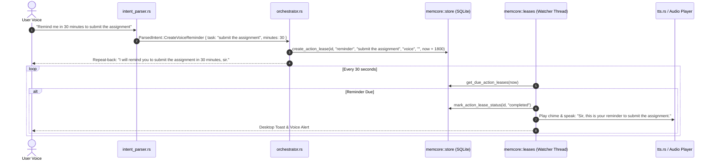

# Feature 113: Alexa-Style Voice Reminders & Proactivity Center

## 1. Executive Summary & User Experience

Smart speakers (Amazon Alexa, Apple Siri) handle reminders effectively due to a critical psychological design pattern: **Immediate Repeat-Back Confirmation**. When a user requests a reminder, the assistant does not simply respond *"Okay"*; it explicitly repeats back the exact task and the scheduled time so the user has 100% confidence it was understood correctly.

NEXUS implements an **Alexa-Style Voice Reminder Center**:
- The user speaks naturally:
  - *"Hey Nexus, remind me in 30 minutes to submit the assignment."*
  - *"Remind me to call Mom in 1 hour."*
  - *"Remind me at 5 PM to check the server build."*
- NEXUS immediately repeats back:
  - *"I will remind you to submit the assignment in 30 minutes, sir."*
- At the exact target timestamp, NEXUS chimes and speaks the reminder:
  - *"Sir, this is your reminder to submit the assignment."*

### Key Guarantees
1. **Mandatory Repeat-Back**: Eliminates ambiguity by confirming task and duration before saving.
2. **Reboot Resilience**: Persisted in SQLite (`action_leases` table). If the laptop is asleep or powered off, overdue reminders speak immediately upon startup.
3. **Granular Proactivity Toggles**: Users can customize in Command Hub whether notifications speak aloud, dock silently, or are disabled.

---

## 2. System Architecture & Lifecycle



---

## 3. Data Model & Lease Storage

Reminders share the durable `action_leases` SQLite schema:

```sql
INSERT INTO action_leases (
    id,
    action_type,          -- 'reminder'
    target_name,          -- 'submit the assignment'
    platform,             -- 'voice'
    target_identifier,    -- ''
    expires_at,           -- timestamp when reminder should fire
    created_at,           -- timestamp when created
    status                -- 'active'
) VALUES (?1, 'reminder', ?2, 'voice', '', ?3, ?4, 'active');
```

### Background Watcher (`memcore::leases.rs`)
The background loop runs every 30 seconds:
```rust
pub fn process_due_leases<R: Runtime>(app: &AppHandle<R>, dir: &Path) {
    let now = chrono::Utc::now().timestamp();
    // 1. Fetch due leases where expires_at <= now
    // 2. Filter for action_type == "reminder"
    // 3. Mark completed
    // 4. Trigger TTS speak via crate::tts::speak_direct
    // 5. Emit desktop notification
}
```

---

## 4. Spoken Phrasing & Natural Language Parsing

In `src-tauri/src/intent_parser.rs`:
Matches intent `ParsedIntent::CreateVoiceReminder { task, minutes }`:
- Patterns:
  - `remind me in (\d+)\s*(?:min|minute)s?\s*(?:to|about)\s*(.+)`
  - `remind me to (.+?)\s+in\s+(\d+)\s*(?:min|minute)s?`
  - `remind me in (\d+)\s*(?:hour|hr)s?\s*(?:to|about)\s*(.+)` $\rightarrow$ `minutes = N * 60`

---

## 5. Granular Proactivity Controls (Command Hub)

Configurable via `frontend/src/settings-sidebar/hub/MemoryPage.tsx`:
- `proactiveReminders`: Enable/disable voice repeat-back and chime alerts.
- `memcoreLeaveBy`: Enable/disable traffic-aware departure reminders.
- `memcoreBriefing`: Enable/disable daily startup briefing.
- `memcoreSession`: Enable/disable restore session prompt after reboot.

All flags persist safely in `settings.json` via `NexusSettings.extra`.

---

## 6. Failure Modes & Edge Cases

| Failure Mode | Mitigation |
|---|---|
| User specifies 0 minutes / past time | Intent parser clamps to minimum duration (1 minute) and confirms: *"I will remind you in 1 minute, sir."* |
| Audio output is muted or meeting is in progress | Background loop checks meeting mode (`meetingModeAuto`); if in a meeting, suppresses TTS and docks a silent notification. |
| Laptop closed during reminder time | On resume/boot, `session::at_boot` detects overdue reminders and delivers them immediately: *"Sir, while your laptop was asleep, your reminder to {task} became due."* |

---

## 7. Verification & Test Suite

1. **Reminder Parsing & Repeat-Back Test**:
   ```bash
   cargo test --lib -- intent_parser::power_and_session_tests::test_executive_assistant_commands
   ```
2. **Lease Expiry & Execution Test**:
   ```bash
   cargo test --lib -- memcore::leases::tests::process_due_leases_handles_expiry
   ```
3. **Full Store Round-Trip Test**:
   ```bash
   cargo test --lib -- memcore::store::tests::action_leases_lifecycle
   ```
