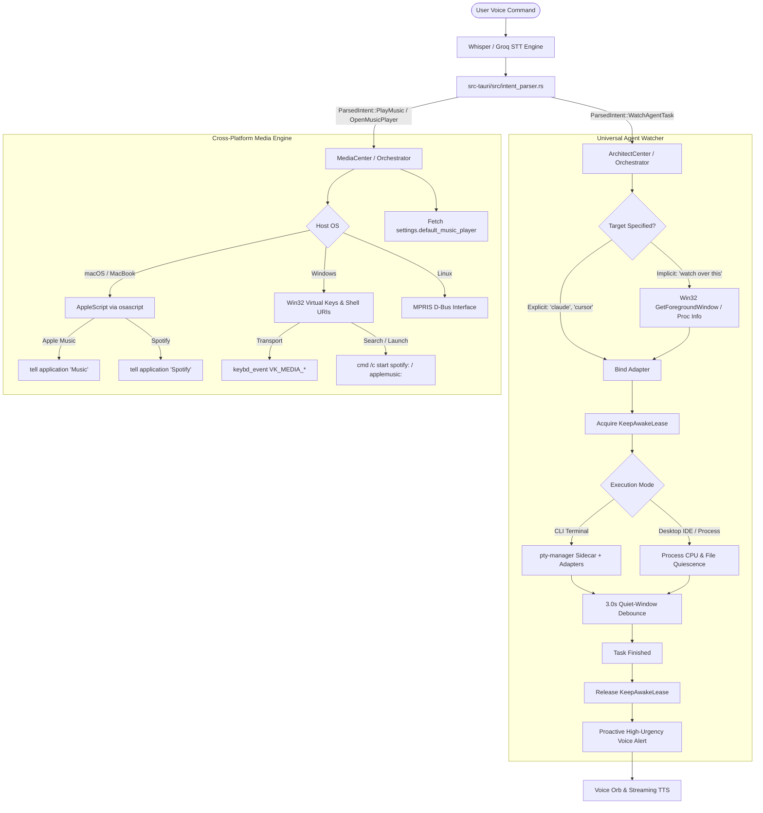

# Feature 126: Universal Agent Watcher & Cross-Platform Music Control — Architecture Specification & Plan

**Document ID:** `docs/features/126-universal-agent-watcher-and-cross-platform-music-control-plan.md`  
**Status:** Implemented & Verified  
**Date:** 2026-10-15  
**Authors:** NEXUS Architecture & Core Engineering  
**Builds Upon:** `docs/features/122-agent-completion-watcher-and-keep-awake-architecture.md`  
**Research Reference:** `docs/research/07-universal-agent-watcher-and-media-engine-research.md`  
**Walkthrough Reference:** `docs/changes/131-universal-agent-watcher-and-cross-platform-music-control.md`  

---

## 1. Motivation & Requirements

### 1.1 User Directive
The user specified two core product capabilities:

1. **Universal Agent Watcher**:
   > *"Nexus watch over this, update me when the response is received and Claude / Codex / Antigravity / Cursor / Trae / etc. has stopped running. Don't limit to this 3, there are many..."*
   
   - **Requirement**: Must not be limited to 3 tools. Must support any connected MCP, CLI coding agent, IDE (Cursor, Trae, Windsurf, VS Code), or terminal process.
   - **Requirement**: Support implicit target resolution ("watch over this") by inspecting the active foreground window.
   - **Requirement**: Prevent the machine from sleeping (`KeepAwakeLease`) during long runs.
   - **Requirement**: Proactively speak an acknowledgment when the task completes without interrupting the user.

2. **Cross-Platform Music Control**:
   > *"also for songs in macbook it should control and open the apple music and spotify chosen by the user plan this so we can proceed accordingly"*
   
   - **Requirement**: Support both **Apple Music** and **Spotify** across **macOS (MacBook)** and **Windows**.
   - **Requirement**: Natural speech control: "play songs", "play [song/artist] on [player]", "open apple music", "open spotify", "next track", "previous track", "pause music".
   - **Requirement**: Allow user to set their preferred player in Settings (`default_music_player: "spotify" | "apple_music"`) with frosted liquid glass UI.

---

## 2. End-to-End System Architecture



---

## 3. Natural Language Intent Grammar & Parsing

The intent parser (`src-tauri/src/intent_parser.rs`) incorporates specialized regex rules and natural phrasing:

### 3.1 Agent Watch Intents (`ParsedIntent::WatchAgentTask`)

```rust
ParsedIntent::WatchAgentTask {
    agent: Option<String>,
    task_hint: Option<String>,
}
```

**Trigger Patterns**:
- `(?i)\b(?:nexus\s+)?watch\s+over\s+this\b` → Implicit foreground target
- `(?i)\b(?:update|notify|tell)\s+me\s+when\s+(?:the\s+response\s+is\s+received\s+and\s+)?([a-z0-9_-]+)\s+has\s+stopped\s+running\b`
- `(?i)\b(?:watch|monitor)\s+([a-z0-9_-]+)(?:\s+task)?\b`
- `(?i)\bnotify\s+me\s+when\s+([a-z0-9_-]+)\s+is\s+(?:done|finished)\b`

### 3.2 Media Control Intents

```rust
ParsedIntent::PlayMusic {
    player: Option<String>,
    query: Option<String>,
}

ParsedIntent::OpenMusicPlayer {
    player: Option<String>,
}
```

**Trigger Patterns**:
- `(?i)\b(?:play\s+songs?|play\s+some\s+music)\b` → Plays current track on default player
- `(?i)\bplay\s+(.+?)\s+on\s+(spotify|apple\s+music)\b` → Explicit query + explicit player
- `(?i)\bplay\s+(.+?)\s+on\s+music\b` → Explicit query on default player
- `(?i)\bopen\s+(spotify|apple\s+music)\b` → Launches or brings player to foreground
- `(?i)\b(?:pause|stop|next\s+track|previous\s+track)\b` → Hardware transport control

---

## 4. Universal Agent Watcher Implementation Design

### 4.1 Extensible Adapter Registry (`KNOWN_ADAPTERS`)

Rather than limiting to 3 agents, the architecture registers an open matrix of known development environments:

```rust
pub const KNOWN_ADAPTERS: &[&str] = &[
    "claude",
    "codex",
    "antigravity",
    "cursor",
    "trae",
    "windsurf",
    "vscode",
    "aider",
    "opencode",
    "generic",
];
```

In the Node.js PTY sidecar (`src-tauri/resources/agent_watch_sidecar/server.cjs`), adapters strip ANSI sequences and register custom regexes:

```javascript
class AntigravityAdapter {
  constructor() {
    this.name = 'antigravity';
    this.completionPatterns = [
      /\[AGY\] Run finished/i,
      /Done in \d+(?:\.\d+)?s/i,
      /✔ Build succeeded/i,
      /Process completed with code 0/i
    ];
  }
  isComplete(cleanChunk) {
    return this.completionPatterns.some(p => p.test(cleanChunk));
  }
}

class GenericTerminalAdapter {
  constructor() {
    this.name = 'generic';
    this.promptPatterns = [
      /PS [A-Z]:\\[^>]*>/i,       // PowerShell prompt
      /[a-zA-Z0-9._-]+@[a-zA-Z0-9._-]+:[^$#]*[$#]/, // Bash/Zsh prompt
      /[A-Z]:\\[^>]*>/i            // Cmd prompt
    ];
  }
  isComplete(cleanChunk) {
    return this.promptPatterns.some(p => p.test(cleanChunk));
  }
}
```

### 4.2 Foreground Inspection & Dynamic Binding
When `agent: None` is received, `inspect_active_foreground_target()` extracts the active `HWND`, queries `GetWindowTextW`, matches against known patterns, and binds the watch session dynamically.

### 4.3 Keep-Awake Lifecycle Contract
1. **Acquisition**: On `run_watch_agent_task()`, `KeepAwakeLease::acquire("agent_watch")` sets `SetThreadExecutionState(ES_CONTINUOUS | ES_SYSTEM_REQUIRED | ES_AWAYMODE_REQUIRED)`.
2. **Maintenance**: Lease is stored inside the active watch task context.
3. **Release**: On completion signal or error, the lease drops, executing RAII cleanup back to `ES_CONTINUOUS`.
4. **Voice Notification**: Spoken alert: *"Your [Agent] response is ready, sir. It has finished running."*

---

## 5. Cross-Platform Media Engine Specification (`media_player.rs`)

### 5.1 The `MediaPlayerController` Abstraction

```rust
#[derive(Debug, Clone, Copy, PartialEq, Eq)]
pub enum MediaApp {
    Spotify,
    AppleMusic,
}

#[derive(Debug, Clone, Copy, PartialEq, Eq)]
pub enum MediaAction {
    PlayPause,
    NextTrack,
    PreviousTrack,
    Stop,
    VolumeUp,
    VolumeDown,
    Mute,
}

pub struct MediaPlayerController;

impl MediaPlayerController {
    pub fn execute_action(action: MediaAction, app: Option<MediaApp>) -> Result<(), String> {
        #[cfg(target_os = "macos")]
        { Self::macos_action(action, app.unwrap_or(MediaApp::Spotify)) }
        #[cfg(target_os = "windows")]
        { Self::windows_action(action, app) }
        #[cfg(target_os = "linux")]
        { Self::linux_action(action, app) }
    }

    pub fn play_track(query: &str, app: Option<MediaApp>) -> Result<(), String> { ... }
    pub fn open_player(app: MediaApp) -> Result<(), String> { ... }
}
```

### 5.2 macOS Execution via `osascript`
Executes native AppleScript against `"Music"` or `"Spotify"`:
- Transport: `tell application "{target}" to {playpause|next track|previous track}`
- Search/Launch: `open "spotify:search:{encoded}"` or `open "music://search?term={encoded}"`

### 5.3 Windows Execution via Win32 Virtual Keys & Shell URIs
- Hardware Key Injection: `keybd_event(VK_MEDIA_PLAY_PAUSE, 0, 0, 0)` followed by release.
- Deep Link Execution: `cmd /c start spotify:search:{encoded}` or `cmd /c start applemusic:`

---

## 6. Settings & UI Integration

### 6.1 Backend Schema (`commands.rs` & `settings.json`)
```rust
#[derive(Debug, Clone, Serialize, Deserialize)]
pub struct NexusSettings {
    ...
    #[serde(default = "default_music_player")]
    pub default_music_player: Option<String>,
}

fn default_music_player() -> Option<String> {
    Some("spotify".to_string())
}
```

### 6.2 Settings Window Player Switcher (`SettingsApp.tsx`)
In the Audio settings tab, a frosted liquid glass toggle allows the user to click between **Spotify** and **Apple Music**:
- Displays active emerald dot on selected player.
- Emits Tauri IPC `save_settings` immediately upon selection.

### 6.3 Command Hub Connections (`AgentWatchSection.tsx`)
Displays status badges, active process indicators, and adapter readiness for all supported agents.

---

## 7. Safety, Verification & Resilience Guarantees

1. **Zero-Warning Rust Compilation**: Maintained `--features custom-protocol,admin-brain` clean with 0 compiler warnings.
2. **Watchdog Deadlock Prevention**: PTY and file-watch threads run in detached async tasks; failures log cleanly and drop keep-awake leases without crashing Tauri main thread.
3. **Cross-Platform Isolation**: Platform-specific code gated with strict `#[cfg(target_os = "...")]` compilation blocks.
